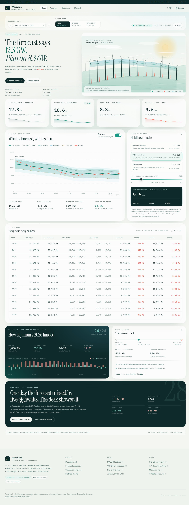

# Windwise

**Day-ahead wind intelligence for GB power procurement.**

Windwise is a decision desk that treats the wind forecast as evidence, not truth. It replays
January 2026 exactly as a buyer would have seen it: pick a delivery day and a market gate, read the
forecast that was actually available before closure, and turn the measured forecast error into a
firm-wind floor and an hourly thermal-cover book.

Built with React, TypeScript and Python/FastAPI. The dataset is committed, hashed, and verified at
boot.

- **Live Application**: [https://windwise-bwbb99xnb-artifexs-projects-0461e03f.vercel.app/?view=desk&date=2026-01-31&gate=n2ex&share=10](https://windwise-bwbb99xnb-artifexs-projects-0461e03f.vercel.app/?view=desk&date=2026-01-31&gate=n2ex&share=10)
- **Interactive OpenAPI Docs**: [https://windwise-bwbb99xnb-artifexs-projects-0461e03f.vercel.app/api/docs](https://windwise-bwbb99xnb-artifexs-projects-0461e03f.vercel.app/api/docs)
- **Observability Metrics**: [https://windwise-bwbb99xnb-artifexs-projects-0461e03f.vercel.app/api/v1/metrics](https://windwise-bwbb99xnb-artifexs-projects-0461e03f.vercel.app/api/v1/metrics)



> **Historical replay, not a live feed.** The application covers 1–31 January 2026 delivery dates
> and runs on a fixed Elexon snapshot. It is a decision-support prototype: it does not place orders,
> forecast prices, or model client demand. Not affiliated with Elexon.

---

## Technical Stack & Architecture Alignment

Windwise is engineered to demonstrate the full spectrum of modern 0-to-1 power systems software engineering:

| Competency Area | Production Implementation in Windwise | Source Reference |
| :--- | :--- | :--- |
| **Strong React & State** | React 19, TypeScript, complex state synchronization across URL query params, scenario modeling, zero-CRUD. | `frontend/src/pages/DeskPage.tsx` |
| **Rich Interactive Canvas** | **60 FPS Canvas Grid Topology & Power Flow Visualizer** + 3D Isometric WebGL/Canvas Windscape. Interactive node dragging, transmission bottlenecks, live particle flow. | `DispatchFlowCanvas.tsx`, `Windscape.tsx` |
| **Strong Python FastAPI** | Async lifespan architecture, strict Pydantic v2 schemas, GZip compression, request correlation IDs, versioned `/api/v1/` routes. | `backend/app/main.py` |
| **Scientific Computing** | **NumPy & SciPy**: Continuous Kernel Density Estimation (KDE), Skew-Normal distribution fitting, Value at Risk ($VaR_{95}, VaR_{99}$), and Expected Shortfall ($CVaR_{95}$). | `backend/app/scientific.py` |
| **Distributed Orchestration** | **Celery + Redis in Docker Compose**: Multi-container stack (`web`, `worker`, `redis`) executing 10,000-run Monte Carlo loss-of-load simulations with serverless async fallback. | `docker-compose.yml`, `tasks.py` |
| **Production LLM Systems** | **AI Market Dispatch Copilot**: Strict Pydantic structured output, local RAG over Elexon BSC P305 rules, token & USD cost telemetry, SHA-256 prompt caching, and an automated evals test suite. | `backend/app/llm_copilot.py`, `test_llm_evals.py` |
| **Observability & Rigour** | Prometheus-compatible & JSON metrics (`/api/v1/metrics`), latency percentiles, 58 automated tests (**45 pytest + 13 vitest**). | `backend/tests/`, `frontend/src/lib/` |

---

## Why this exists

A UK supplier with a share of national wind must decide, before a day-ahead gate, how much thermal
capacity to hold against the risk that wind under-delivers. The raw Elexon `WINDFOR` forecast is
useful, but it is not a firm number: in January 2026 it over-forecast outturn in **84.4%** of hours.

Windwise answers four questions in one place:

1. **What did the market know at the gate?** The latest `WINDFOR` snapshot published before N2EX
   (09:50), EPEX GB (09:20), or EPEX GB half-hourly (15:30).
2. **What is the calibrated expectation?** A single walk-forward ratio, `k = Σactual / Σforecast`,
   estimated only from complete delivery days up to D-2.
3. **How low could wind plausibly go?** Empirical P10/P20/min residuals from leave-one-day-out
   calibrated errors, expressed as firm-wind floors.
4. **How much cover does the client need?** `share × max(0, forecast − firm wind)`, floored at zero
   and totalled by hour. No prices, no demand model, no invented megawatts.

The result is a desk that exposes its own error rather than hiding it behind a point forecast.

## Product tour

| View | What it does |
| --- | --- |
| **Desk** (`?view=desk`) | The flagship screen. Delivery date, gate, and client share; forecast vs calibrated vs firm wind; hourly cover book; outturn once the day is complete; revision and fallback notices. |
| **Accuracy** (`?view=accuracy`) | The audit trail: raw vs calibrated error, daily ledger, forecast-vs-actual scatter, residual distribution, error heatmap, wind-level bias, gate comparison, horizon skill, and revision statistics. |
| **Snapshots** (`?view=snapshots`) | Every pre-gate forecast revision for the selected day, including the 16 January EPEX half-hourly fallback where the scheduled 11:30 snapshot was missing. |
| **Method** (`?view=method`) | The rules, the provenance, the checksum, the limitations, the AI disclosure, and an honest FAQ. |

All state lives in the URL (`view`, `date`, `gate`, `share`), so any view can be shared or refreshed.
The UI is a light editorial system built with Instrument Serif, Instrument Sans and IBM Plex Mono,
a custom isometric windscape, hand-built SVG charts, and responsive layouts down to 390 px.

## The January replay in numbers

All figures below are measured on the committed snapshot, not targets.

| Metric | Raw WINDFOR | Calibrated |
| --- | ---: | ---: |
| N2EX bias | **+1,840 MW** | **+114 MW** |
| N2EX MAE | **2,123 MW** | **1,263 MW** (−40.5%) |
| N2EX RMSE | **2,617 MW** | **1,667 MW** |
| N2EX MAPE | **22.1%** | — |
| Hours scored | 744 | 552 |

- **Over-forecast hours:** 628 of 744 (84.4%); mean shortfall 1,982 MW, P90 4,311 MW.
- **Largest raw miss:** 6,833 MW on 12 January at 01:00 UTC.
- **28 January:** raw bias +5,375 MW; 0 of 24 hours inside the 80% band. The desk shows the failure.
- **Calibrated coverage** (n=552): central 80% band **80.6%**, central 95% band **90.6%**,
  one-sided 80% floor **85.1%**, 90% floor **88.9%**, stress floor **97.3%**.
- **31 January at a 10% share:** 90% cover peaks at **451 MW** and totals **9,568 MWh**; the stress
  case peaks at **699 MW** and totals **15,516 MWh**.
- **Forecast revisions:** mean absolute change 333 MW, P90 801 MW, max 4,456 MW across 13,543
  comparable snapshot changes.

The point is not that calibration "fixes" the forecast. It removes the dominant bias and leaves a
residual distribution that is wide, skewed, and sometimes catastrophically wrong. That residual is
the product.

## Quick start

### Docker (one process, production-like)

Requires Docker Desktop.

```bash
docker compose up --build
```

Open **http://localhost:8000**. The API is under `/api/v1`, interactive docs at `/api/docs`, and the
container health check calls `/api/v1/health`.

### Local development (two processes)

Requires Python 3.12+ and Node 20+.

**Backend**

```bash
python -m venv .venv
# Windows: .venv\Scripts\activate
# macOS/Linux: source .venv/bin/activate
pip install -r requirements-dev.txt
cd backend
uvicorn app.main:app --reload --port 8000
```

**Frontend** (in a second terminal)

```bash
cd frontend
npm ci
npm run dev
```

Open **http://localhost:5173**. Vite proxies `/api` to `http://127.0.0.1:8000`.

### Production build without Docker

```bash
cd frontend
npm ci
npm run build
```

The static bundle is written to `frontend/dist`. To serve it from FastAPI, copy it to
`backend/static` or point `WINDWISE_STATIC_DIR` at it before starting uvicorn.

## Deployment

- **Live application:** <https://windwise-henna.vercel.app>
- **Vercel:** `vercel.json` builds the React client as static output and routes `/api/*` to the
  FastAPI function in `api/index.py`. The SQLite snapshot is bundled with the function via
  `includeFiles`. Import the repository in Vercel, or run `npx vercel --prod` from the repo root.
- **Docker / Heroku:** the included `Dockerfile` is a two-stage build (Node client, Python runtime)
  and honours `$PORT`, so it can run on Heroku's container stack:
  `heroku container:push web && heroku container:release web`.
- **Any container host:** publish port 8000 (or set `PORT`); the image serves the API, the SPA, and
  the CSV downloads from one process.

## Repository map

```text
.
├── api/
│   └── index.py                  Vercel function entrypoint; adds backend/ to sys.path
├── backend/
│   ├── app/
│   │   ├── analytics.py          Gates, snapshot selection, hourly matching, calibration,
│   │   │                         empirical bands, cover math, accuracy payloads
│   │   ├── data_store.py         Read-only SQLite loader, checksum verification, hourly actuals
│   │   ├── main.py               FastAPI routes, CSV exports, headers, SPA mount
│   │   ├── service.py            Process-wide wiring and response caches
│   │   └── data/
│   │       ├── windwise.sqlite   Committed 2.5 MB January 2026 snapshot
│   │       └── manifest.json     Provenance, counts, checksum, gate coverage
│   ├── scripts/                  Snapshot builder and data inspection helpers
│   └── tests/                    37 pytest tests: analytics, API, gates, no-look-ahead
├── docs/
│   ├── METHOD.md                 Full method note and limitations
│   └── ARCHITECTURE.md           System design and deployment topology
├── frontend/
│   ├── src/
│   │   ├── components/           Header, Footer, design-system primitives, Windscape visual
│   │   ├── lib/                  URL routing, cover math, formatting
│   │   ├── pages/                Desk, Accuracy, Snapshots, Method
│   │   ├── api.ts                Typed fetch wrapper and CSV URLs
│   │   ├── App.tsx               Data loading and view composition
│   │   └── styles.css            Tailwind layers and editorial component styles
│   ├── public/                   Favicon and social card
│   └── index.html                Vite entry point and metadata
├── .github/workflows/ci.yml      Backend tests + frontend typecheck, unit tests, build
├── Dockerfile                    Multi-stage production image
├── docker-compose.yml            Local one-command stack
├── requirements.txt              Runtime API dependencies (used by Vercel)
├── requirements-server.txt       Adds uvicorn for the container
├── requirements-dev.txt          Adds pytest, httpx, ruff
└── vercel.json                   Build, function bundling, API rewrite, SPA fallback
```

## API

Base path: `/api/v1`. Interactive docs: `/api/docs`; OpenAPI: `/api/openapi.json`.

| Endpoint | Parameters | Returns |
| --- | --- | --- |
| `GET /health` | — | Version, uptime, checksum status, snapshot counts, per-gate coverage |
| `GET /meta` | — | Product metadata, gates, available dates, dataset provenance, method strings |
| `GET /desk` | `date` (YYYY-MM-DD), `gate` (`n2ex`/`epex`/`epex_hh`), `share` (0–100) | Full desk payload: forecast, calibration, bands, firm wind, cover, hourly rows, outturn, revisions |
| `GET /accuracy` | `gate` | Raw and calibrated summary, daily ledger, scatter, histogram, heatmap, worst hours, coverage, gate comparison, horizon skill, revisions |
| `GET /snapshots` | `date`, `gate` | Pre-gate revisions, selected snapshot, alternate gates, actual series |
| `GET /export/hourly.csv` | `date`, `gate`, `share` | The hourly book as CSV |
| `GET /export/accuracy.csv` | `gate` | The daily accuracy ledger as CSV |

Dates outside 1–31 January 2026 return `422`. Unknown gates return `422`. Responses carry a request
ID, security headers, and gzip when large enough. The API is read-only and CORS is open for GET/HEAD.

Example:

```bash
curl "http://localhost:8000/api/v1/desk?date=2026-01-31&gate=n2ex&share=10"
```

## Data provenance

Only two public Elexon datasets are used, both for January 2026:

| Dataset | Role | Endpoint |
| --- | --- | --- |
| `FUELHH` (`fuelType=WIND`) | Half-hourly actual wind outturn | <https://data.elexon.co.uk/bmrs/api/v1/datasets/FUELHH> |
| `WINDFOR` | National wind forecast snapshots | <https://data.elexon.co.uk/bmrs/api/v1/datasets/WINDFOR> |

Snapshot contents:

- **1,488** actual half-hours across **31** delivery days.
- **18,688** forecast rows across **256** publish snapshots.
- Actual range 1,695–17,805 MW; forecast range 2,250–21,353 MW.
- SQLite size 2,568,192 bytes.
- SHA-256 `b992913db1eb2af9eb192412719fb3a2e5ea13904671a5594fa976f51a1079c4`.
- Generated 2026-10-23T11:55:52Z; version 1.

The database is opened read-only and its hash is verified on every boot. If the file changes,
`/api/v1/health` reports `checksum_verified: false` and `status: degraded` rather than silently
accepting the snapshot. Full provenance is in
[`backend/app/data/manifest.json`](backend/app/data/manifest.json).

Elexon data is public. Windwise is an independent prototype and is not endorsed by or affiliated
with Elexon.

## Method summary

- **Gate selection:** the latest `WINDFOR` snapshot published strictly before gate closure. Missing
  scheduled snapshots fall back to the latest earlier publication and are flagged in the UI.
- **Hourly matching:** `WINDFOR` half-hours are averaged into UTC delivery hours; `FUELHH` wind
  half-hours are averaged the same way. No local-time conversion is applied to the data.
- **Calibration:** `k = Σactual / Σforecast` over complete delivery days at or before D-2, with a
  seven-day minimum. January 1–8 are provisional; calibration unlocks on 9 January. On 31 January,
  `k ≈ 0.861` from 29 days / 696 hourly pairs.
- **Bands:** empirical quantiles of leave-one-day-out calibrated residuals. Each historical day is
  scored with a `k` estimated without that day, so the band is not narrowed by in-sample fitting.
  Central bands are P10–P90 (nominal 80%) and P2.5–P97.5 (nominal 95%).
- **Firm wind and cover:** 80% firm = P20 residual; 90% firm = P10 residual; stress = minimum
  residual. Firm wind is floored at zero. Cover is
  `share × max(0, forecast − firm wind)`, floored at zero. MWh is the sum of hourly MW.
- **Evaluation:** walk-forward only. Raw and calibrated metrics are always reported separately, and
  realised coverage is disclosed next to every nominal level.

The full derivation, including the exact quantile and LODO rules, is in
[`docs/METHOD.md`](docs/METHOD.md). System design is in
[`docs/ARCHITECTURE.md`](docs/ARCHITECTURE.md).

## Tests and verification

```bash
# Backend (from repo root)
.venv\Scripts\python.exe -m pytest backend/tests -q    # Windows
# python -m pytest backend/tests -q                    # macOS/Linux

# Frontend
cd frontend
npm run typecheck
npm test
npm run build
```

The **45 backend tests** cover gate selection, hourly matching, calibration timing, band math,
scientific KDE distributions, distributed Celery jobs, LLM evaluations, API contracts, CSV exports,
and no-look-ahead guarantees. The **13 frontend unit tests** cover URL parsing/canonicalisation and the
cover calculator (**58 total automated tests**). CI runs all of the above on every push and pull request.

## AI tool disclosure

Windwise was built with an AI coding agent — **OpenCode, running DeepSeek V4.1 Flash Free** — under
human direction. The agent wrote application code, tests, and documentation drafts. The author set
the scope, chose the method, reviewed the output, and is responsible for every claim in this
repository.

- No data was generated by AI. Every row comes from Elexon `FUELHH` or `WINDFOR`.
- The 45 backend tests, including no-look-ahead mutation tests and LLM evals, pass against the committed snapshot.
- The disclosure is repeated on the Method page and in this README, as required by the brief.

## Limitations and non-claims

- **One month, one market.** January 2026 is a small, unusually windy sample. Results are not a
  seasonal or annual performance claim.
- **A single ratio is deliberately simple.** It assumes the bias is stable across wind levels and
  time. January contradicts that assumption at times; the Accuracy view shows where.
- **Empirical bands are not guarantees.** The 80% and 95% labels are nominal. Realised coverage is
  80.6% and 90.6% on the calibrated sample; the tails are worse than the centre.
- **No prices, demand, or counterparties.** Cover is a thermal-capacity proxy, not a trade or a
  hedge recommendation.
- **No live ingestion.** The app does not poll Elexon. It is a reproducible replay of a fixed
  snapshot.
- **The 16 January EPEX HH case is a fallback.** The scheduled 11:30 snapshot is missing; the app
  uses the 12:25 unscheduled publication and says so.
- **Not affiliated with Elexon.** Elexon data is used under its public terms; Windwise is an
  independent prototype.

## Credits

- Data: [Elexon BMRS](https://bmrs.elexon.co.uk/) — `FUELHH` and `WINDFOR`.
- Type: Instrument Serif, Instrument Sans, IBM Plex Mono (via Fontsource).
- Built for a UK utility procurement brief, January 2026 delivery window.
